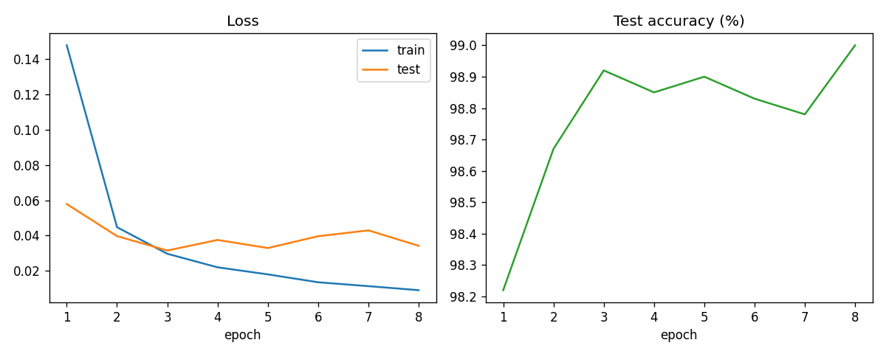

# Check_mnist

MNIST digit classification with a small CNN (PyTorch). The script downloads MNIST,
trains on GPU (falls back to CPU), logs per-epoch metrics, and saves plots to `results/`.

## Run

```bash
pip install -r requirements.txt
python mnist.py
```

On first run MNIST is downloaded to `./data/`. Outputs go to `results/`:
`metrics.csv`, `mnist_cnn.pt` (model weights, not tracked in git), `curves.png`,

### On a Jupyter / OnDemand GPU session

```bash
python mnist.py > mnist_run.log 2>&1 &
```

Install matplotlib first if the environment lacks it (`pip install matplotlib`;
inside a virtualenv do not use `--user`).

## Model and training

Conv(1-32) - Conv(32-64) - MaxPool - Dropout(0.25) - FC(9216-128) - FC(128-10),
Adam (lr 1e-3), batch 128, 8 epochs, inputs normalised with mean 0.1307 / std 0.3081.

## Results (NVIDIA A100-SXM4-40GB, about 9 s total training)

| Epoch | Train loss | Test loss | Test acc |
|---|---|---|---|
| 1 | 0.1479 | 0.0578 | 98.22% |
| 3 | 0.0296 | 0.0315 | 98.92% |
| 8 | 0.0090 | 0.0342 | **99.00%** |

Full per-epoch numbers: [results/metrics.csv](results/metrics.csv).


